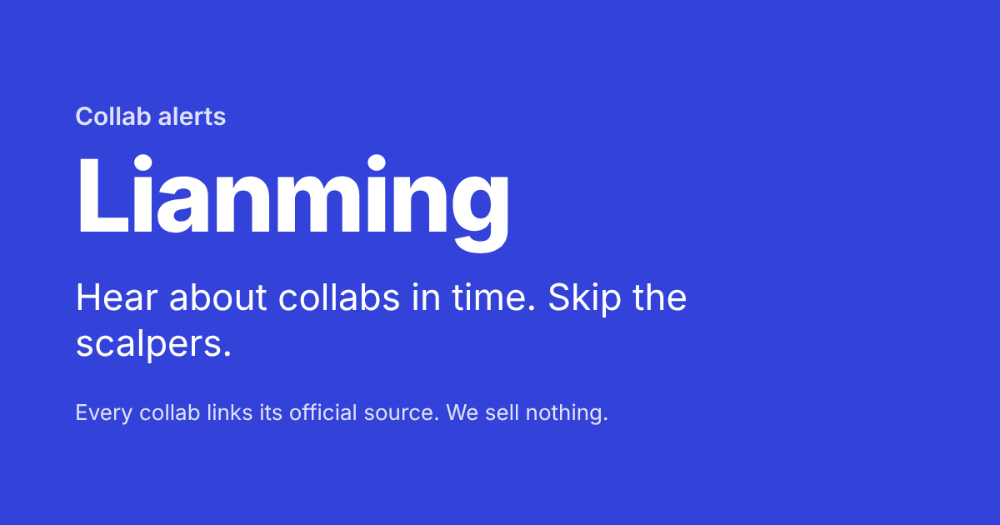
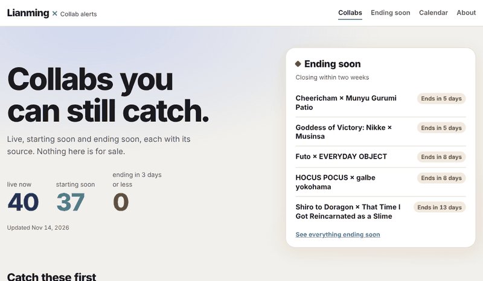
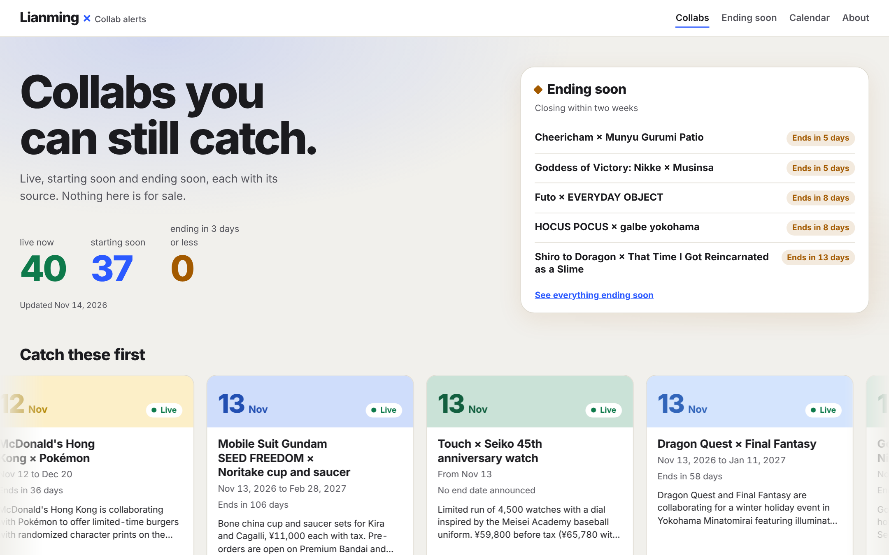
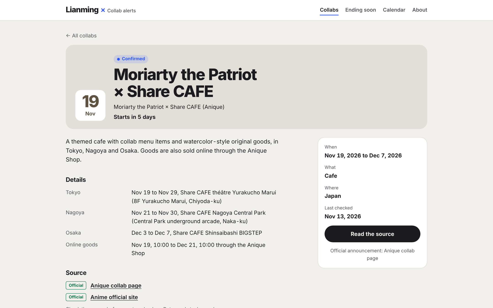
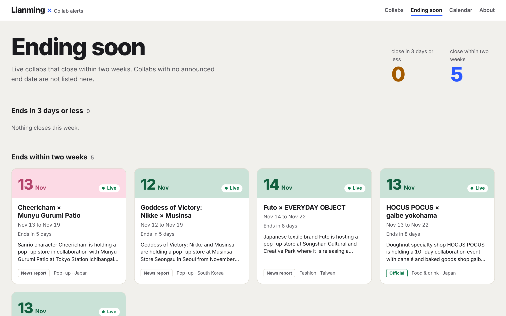
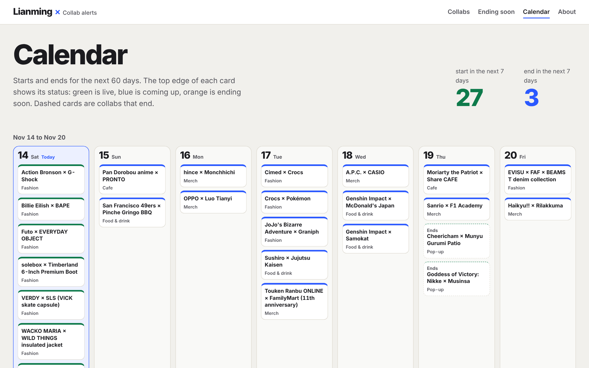
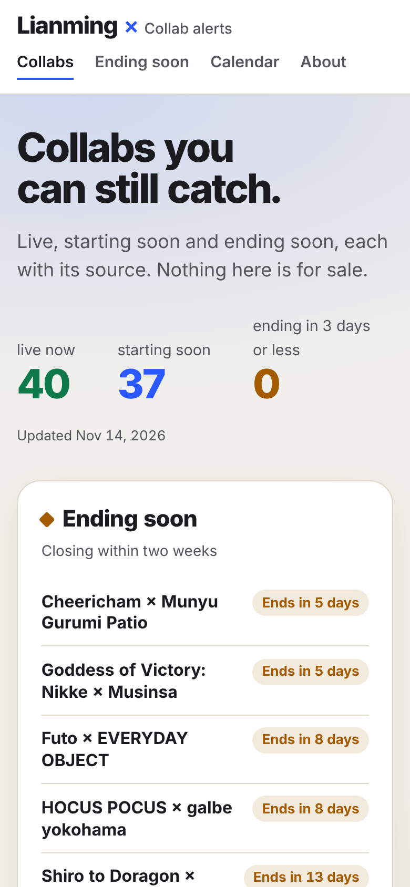
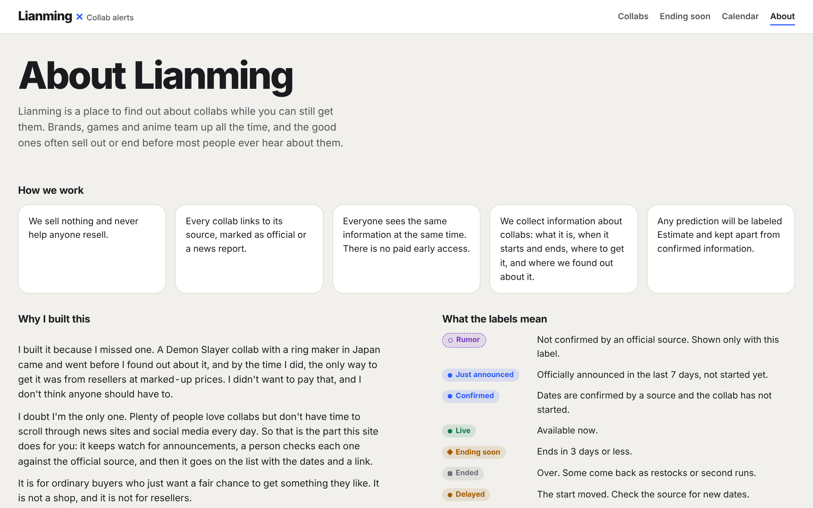

  

<h3 align="center">That collab you wanted? Don't find out after it sold out.</h3>

  <a href="https://lianming-ckh.pages.dev"><b>▶ Open Lianming</b></a> &nbsp;·&nbsp;
  <a href="https://lianming-ckh.pages.dev/ending-soon/">⏳ Ending soon</a> &nbsp;·&nbsp;
  <a href="https://lianming-ckh.pages.dev/calendar/">🗓 Calendar</a> &nbsp;·&nbsp;
  <a href="https://lianming-ckh.pages.dev/feed.xml">📡 RSS</a>

  
  
  
  
  

---

## Ever miss a collab by one day?

A themed cafe. A limited merch drop. A burger-and-toy meal. A pop-up store that closes Sunday.

You hear about it **after** it's gone, and the only way to get one is from a scalper at triple the price.

**Lianming (联名, "collab")** fixes that. It shows you what is **live**, what is **starting soon** and what is **about to end**, with a link to the official source for every single one. Nothing to sign up for. Nothing for sale.

<picture>
  <source media="(prefers-color-scheme: dark)" srcset="screenshots/demo-dark.gif">
  
</picture>

## Why people use it

| | |
|---|---|
| **Know in time** | Live, starting soon and ending soon, at a glance. Big numbers right on the home page. |
| **Find it fast** | Search a name, brand, place or nickname. Filter by cafe, food, game, merch, pop-up or anime. |
| **Trust it** | Every collab links its source and says if it is official or a news report. Rumors are labelled Rumor. |
| **Price in your currency** | Type a currency and see about how much it costs. |
| **Follow it your way** | Calendar page, Ending soon page, or an RSS feed in any reader. |

<picture>
  <source media="(prefers-color-scheme: dark)" srcset="screenshots/home-dark.png">
  
</picture>

<picture>
  <source media="(prefers-color-scheme: dark)" srcset="screenshots/collab-dark.png">
  
</picture>

<table>
  <tr>
    <td width="50%">
      <picture>
        <source media="(prefers-color-scheme: dark)" srcset="screenshots/ending-soon-dark.png">
        
      </picture>
    </td>
    <td width="50%">
      <picture>
        <source media="(prefers-color-scheme: dark)" srcset="screenshots/calendar-dark.png">
        
      </picture>
    </td>
  </tr>
</table>

  <picture>
    <source media="(prefers-color-scheme: dark)" srcset="screenshots/home-phone-dark.png">
    
  </picture>

## Built on rules that never change

1. **It sells nothing.** No shop, no resale, no scalping, no affiliate links.
2. **Every collab links its source.** Official or news report, always shown.
3. **Same information, same time, for everyone.** No paid early access.
4. **No brand logos.** Plain names and a neutral design.
5. **Data about collabs, not about you.** No trackers, no cookies, nothing saved on your device, no third-party scripts or fonts. Only anonymous totals, like how many times a collab page was opened.
6. **Your location is what you choose.** Never tracked.
7. **Honest labels:** Rumor, Confirmed, Live, Ending soon, Ended, Estimate. A date that is not in the source is never invented.

## Questions

**Is it free?** Yes.

**Do you sell collab items or link to resellers?** No. Never. Every link goes to the official source or a news report.

**Do you track me?** No. There are no cookies and nothing is saved on your device.

**How do collabs get on the site?** A collector reads public news from many countries and languages. An AI reader checks each one and only adds an entry when it is very sure, and the page says it was added automatically. Anything unsure gets a second look from other outlets, and a person can still review, fix or remove anything.

**Can I trust the dates?** Dates are shown as the source gives them. If a source gives no date, the site says so. Always check the source before you travel or buy.

<picture>
  <source media="(prefers-color-scheme: dark)" srcset="screenshots/about-dark.png">
  
</picture>

## Coming next

- 🌏 Filter by region: Japan, North America, Taiwan and Hong Kong, Worldwide
- 🔔 Alerts, so you hear about a collab before it ends
- 🔮 Predictions, clearly labelled as estimates
- 🌐 More countries, more sources

## Spotted something we missed?

[Open an issue](../../issues) and tell us. Tips make the site better for everyone.

---

This repository only describes the project. The site itself is not open source.

